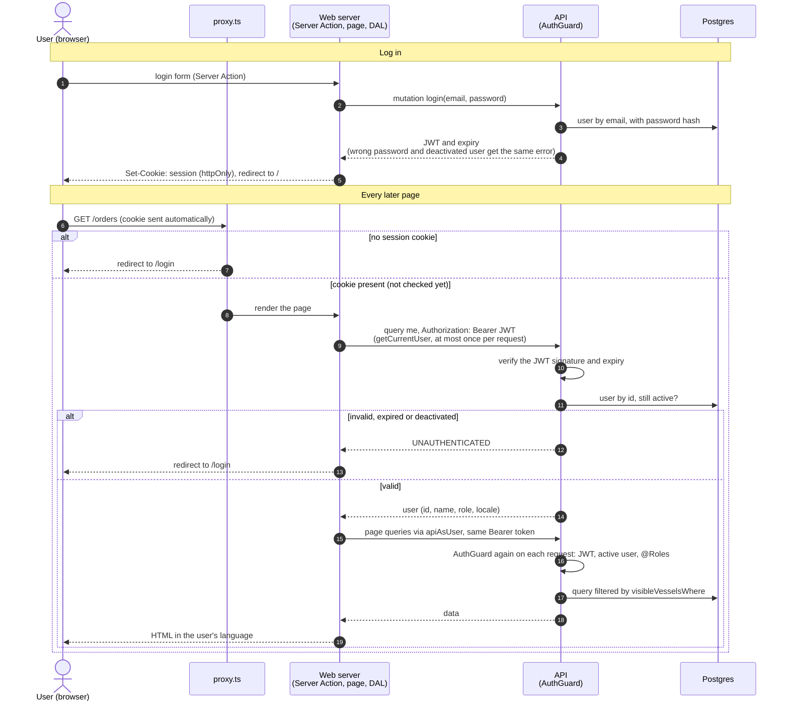
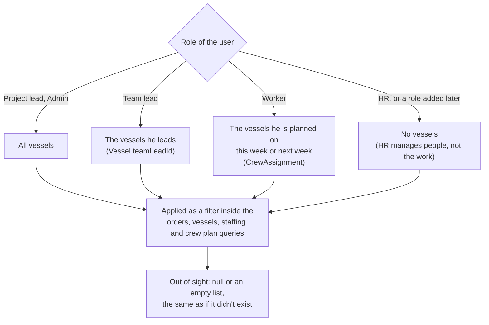
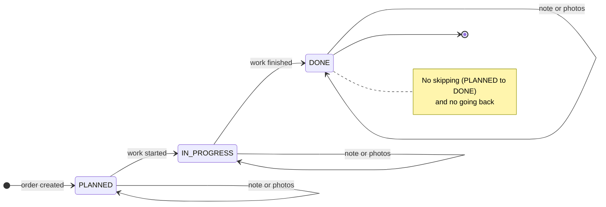
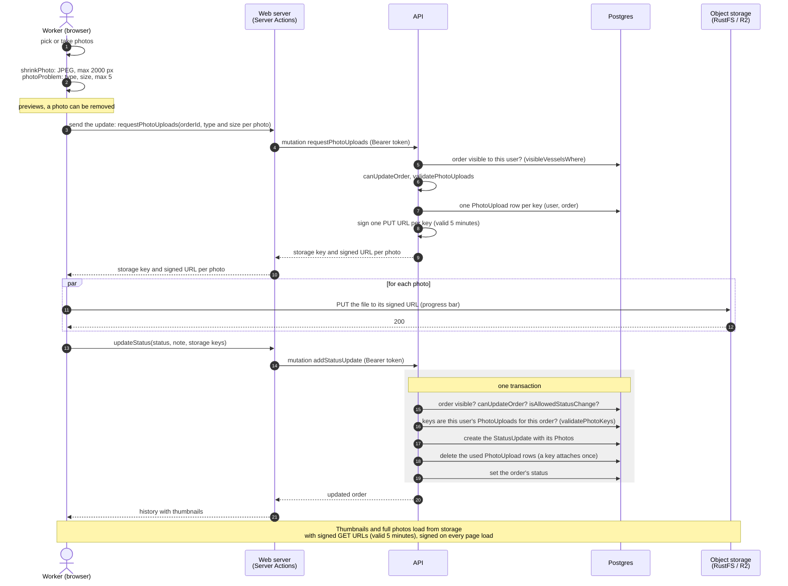

# Core flows

How the main flows in HullOps work, as diagrams with links to the code that implements each step. GitHub renders the [Mermaid](https://mermaid.js.org) diagrams in place.

Keep these in step with the code: a PR that changes one of these flows updates its diagram.

- [Login and auth](#login-and-auth)
- [Which vessels a user sees](#which-vessels-a-user-sees)
- [Order status](#order-status)
- [Photo upload](#photo-upload)

## Login and auth

The browser never holds the API token. The web app keeps it in an httpOnly cookie and calls the API on the server, so a script injected into the page has nothing to steal.

- **Two checks, on purpose.** [`proxy.ts`](../apps/web/src/proxy.ts) (Next.js 16's middleware) only checks that a cookie exists. That's cheap and catches visitors who were never logged in. The real check is in the data access layer, [`dal.ts`](../apps/web/src/lib/server/dal.ts), which asks the API who the token belongs to.
- **The API trusts no one.** The global [`AuthGuard`](../apps/api/src/auth/auth.guard.ts) runs on every request except those marked `@Public()`. It verifies the JWT and then loads the user ([`auth.service.ts`](../apps/api/src/auth/auth.service.ts)), so deactivating a user ends their sessions at once, not when the token expires. `@Roles(...)` then limits endpoints to certain roles.
- **Language.** After login the UI uses the user's `locale` setting, not the browser's.

## Which vessels a user sees

One rule decides what someone sees of the work: [`visibleVesselsWhere`](../apps/api/src/vessels/vessel-scope.ts). It returns a Prisma filter, which every query on orders, vessels, staffing and the crew plan includes. So it's one database query, and the rule can't drift apart between screens.

- **Out of sight looks like missing.** An order on a vessel you can't see gives the same answer as an order that doesn't exist, never a "forbidden". So the API doesn't reveal what exists elsewhere.
- **The worker's window moves on its own.** The project lead's weekly crew plan decides it, so a worker sees next week's vessel as soon as he is planned there, and loses last week's without anyone changing a setting.
- **Safe default.** The `switch` ends with "no vessels", so a new role sees nothing until someone decides what it should see.

## Order status

An order moves forward one step at a time. Each status update is kept as history (`StatusUpdate`), with an optional note and photos.

- **The rules** are plain functions in [`order-rules.ts`](../apps/api/src/orders/order-rules.ts): `isAllowedStatusChange` allows the same status or one step forward. An update that keeps the status needs a note or photos, otherwise it says nothing.
- **Who may post an update** (`canUpdateOrder`): project leads on every order, the order's team, and the team lead of the order's vessel. Administrators manage the app, not the work, so they can't.
- **Overdue** is not a status. An order is overdue when its due date has passed and it isn't `DONE` (`isOverdue`). It's computed whenever it's needed, never stored, so it can't go stale.

## Photo upload

Photos go from the phone straight to object storage. They don't pass through the web server or the API, which matters on a slow connection on the yard. The API only hands out permissions to upload and records what was uploaded.

- **Checked twice.** The browser checks type, size and count with the same limits as the API ([`photos.ts`](../apps/web/src/lib/photos.ts)), so a worker hears about a wrong file before waiting for an upload. The API checks again ([`photos.service.ts`](../apps/api/src/photos/photos.service.ts)), because a browser can be bypassed.
- **Only keys the API handed out.** Every key is recorded as a `PhotoUpload` for this user and order before its URL is signed. `addStatusUpdate` ([`orders.service.ts`](../apps/api/src/orders/orders.service.ts)) accepts only those keys, and only once, so no one can attach someone else's file or a file from another order.
- **Nothing half done.** If an upload fails, nothing has been attached yet, and the worker tries again from the start. The status update and its photos are saved in one transaction.
- **CORS.** Because the browser talks to the bucket directly, the bucket must allow the web app's origin (`storage-init` in [`docker-compose.yml`](../docker-compose.yml) locally, [DEPLOYMENT.md](../DEPLOYMENT.md) for R2). The trade-offs of object storage are in [ADR 0001](adr/0001-object-storage.md).
